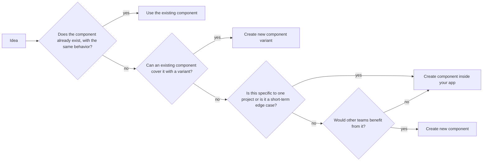
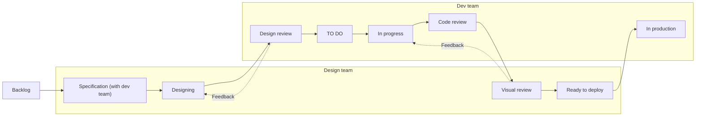
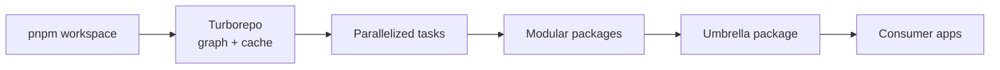
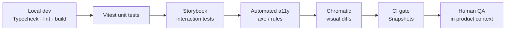
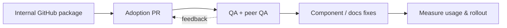

<div class="absolute top-8 left-10 tag">INTERVIEW</div>
<div class="absolute right-10 top-8 text-sm text-gray-400">22 slides</div>

# From a library to<br><span style="color:#FFCC00">a design system.</span>

<div class="mt-8 text-xl max-w-3xl">Spectra Design System @ Vusion — a field guide to building, governing, and scaling a frontend platform.</div>

<div class="absolute bottom-14 left-18 flex gap-3">
  <span class="badge">Design System Lead</span><span class="tag">Spectra @ Vusion</span>
</div>

<!--
Speed creates value only if it's reliable.
It's not about how to code a button, but how to make it used by dozens of developers across multiple teams. And that, without depending on a single person.

Spectra — tokens, composants, packages, documentation, validation et adoption.
-->

---
layout: center
---

# Spectra

Spectra is Vusion’s Design System: a React-based foundation built from scratch with governed tokens and slots, reusable packages, automated validation, and measured adoption.

---
layout: statement
---

# What is a Design System?

[A design system is] a set of <span v-mark.yellow>connected patterns and shared practices</span>, coherently organized to serve the purposes of a digital product. - Alla Kholmatova

<!--
Building SaaS products at scale creates a silent problem: inconsistency compounds over time.

Without a shared system, designers make slightly different decisions on every screen. Developers implement slightly different components in every feature. The result is an interface that feels fragmented, and a team that spends more time reconciling differences than shipping value.

A Design System solves this by creating one shared language between design and development — a single source of truth that answers "how should this work?" before the question is even asked.

For Vusion, this matters beyond aesthetics. Our products help people make sense of complex retail data. When the interface is inconsistent or unpredictable, it creates cognitive friction that gets in the way of insight. A coherent system directly supports our commitment to human-centered technologies.
-->

---

<div class="kicker">CONTEXT</div>

# A Design System at scale is a **socio-technical system**

<div class="grid mt-8">
<div class="card"><h3>01 · Design</h3><p>Primitives, accessible, composable.</p></div>
<div class="card"><h3>02 · Contracts</h3><p>Tokens, props, slots, events, states.</p></div>
<div class="card"><h3>03 · Validation</h3><p>Stories, interaction, a11y, visual, CI.</p></div>
<div class="card"><h3>04 · Adoption</h3><p>Incremental rollout, metrics, feedback.</p></div>
</div>

<blockquote class="mt-7">The value is not in a component library. It is in reducing the cost of change for teams.</blockquote>

<!--
Notes : The panel should take away: start from reality, reason in contracts, distinguish React architecture from platform architecture, treat quality as a continuous flow, and own the trade-offs.


Primitives for common language

Contracts for predictible components

Modular architecture to be used by multiple consumers

Validation for accessibility and reliability

Monitor adoption and get feedback to reduce friction
-->

---

<div class="kicker">ACT 1 · DESIGN</div>

# Establish design principles

<div class="grid mt-8">
<div class="card"><h3>Serve the user, not the screen</h3><p>Optimize clarity, speed and confidence.</p></div>
<div class="card"><h3>Personality lives in the system</h3><p>Visual identity through color palette, icons, typography and spatial rhythm.</p></div>
<div class="card"><h3>Constraints are the product</h3><p>Work with the system, not around it.</p></div>
<div class="card"><h3>Accessible and reliable by default</h3><p>The interface must behave predictably and meet accessibility standards.</p></div>
</div>

<!--
Serve the user

When a design decision feels clever but adds friction, it is wrong. When a component is technically elegant but harder to understand, it is wrong. The retail manager at the end of the chain is always the final judge.

Personality

Designing or building outside the system doesn't add character — it breaks it. Custom styles and one-off components don't express creativity, they create inconsistency that the user pays for.

Constraints

The system is intentionally restrictive. Developers cannot apply arbitrary styles. Designers cannot use components that don't exist in the library. This is not a limitation — it is the mechanism by which quality scales.

Every constraint exists to protect the experience at the end of the chain. When the system feels too rigid, the right answer is to improve the system — not to work around it.

Acessibility

The interface and the components must be predictible.
Accessibility and reliability are not features to be added later — they are baseline qualities baked into every component so teams never have to solve for them individually. A component that is not accessible is not finished.
-->

---

<div class="kicker">ACT 1 · DESIGN</div>

# Design Decision Workflow


<div class="mt-4">

> Anyone can contribute to Spectra, but must follow the decision path before any implementation and should be challenged by one member of the design system team.

</div>

---

<div class="kicker">ACT 1 · DESIGN</div>

# Ground rules
 
<div class="mt-4 mb-4">
<ul>
    <li>Ticket first, tracked in Jira (new Project and Kanban board).</li>
    <li>Exploration is allowed - modification is not (in Figma).</li>
    <li>Design and dev move in sequence, not in parallel.</li>
</ul>
</div>



<div class="mt-4">

> Code is the source of truth. Figma reflects and communicates what exists in code. When the two diverge, code wins until Figma is updated.

</div>

<!--
Any component need to have a ticket first : creation, new variant, fix, etc.
Teach the Design Team how Jira and Kanban Board works.
Create ticket templates

NO FIGMA BRANCHING
No organization level accounts on Figma, so no modification on existing/used components. Explore/POC aside. With organization level you can have branches to work on existing components.

Wait for Design to be finished. Then review made by the design system developers (me) => Feedback (color variants ? component structure doesn't fit with code ? Use slot instead of a text ?)
-->

---

<div class="kicker">ACT 1 · DESIGN</div>

# Build a shared language

<div class="grid mt-5">
    <div class="card">
    <h3 class="mb-2">Domain-Driven Design</h3>
    <ul>
    <li>Variables and tokens need a formal, shared vocabulary.</li>
    <li>Design and engineering conventions need to converge.</li>
    <li>Component's APIs are still implicit.</li>
    </ul>
    </div>
    <div class="card">
    <h3 class="mb-2">1:1 Design / Dev</h3>
    <ul>
        <li>Figma variant/boolean = code prop</li>
        <li>Clarified tokens</li>
        <li>Instance swaps</li>
        <li>Explicit slots, when justified</li>
        <li>Reusable conventions</li>
    </ul>
    </div>
</div>

<div class="card mt-4"><h3>Avoid</h3><p>Monoliths, too many booleans, variants only in Figma, arbitrary overrides in code, design / code divergence.</p></div>

<!--
Same vocabulary for variables/tokens :

Stroke or border ?
Shadow, outline or ring ?

Same conventions

A Figma prop or boolean should have an equivalent in the code
A slot map to a ReactNode (or a Slot in Stencil)

Components APIs

Stay implicit: focus, hover, onValueChange, etc.
-->

---

<div class="kicker">ACT 1 · DESIGN</div>

# Contracts before pixels

<div class="grid mt-6">
<div class="card"><h3 class="mb-2">Questions for each component</h3>
<ul>
<li>What are the real states?</li><li>Which props are essential?</li><li>Which values should become tokens?</li><li>Which structure remains governed?</li><li>Where should composition happen?</li>
</ul></div>
<div class="card"><h3 class="mt-4 mb-2">Card or Header components</h3>
<p>Closed: <span v-click.fade-in>the application creates hacks.</span></p><p>Completely free: <span v-click.fade-in>consistency disappears.</span></p><p><strong>Slot: <span v-click.fade-in>stable structure + composable content.</span></strong></p></div>
</div>

<!-- 
Too closed: Consumers reach for hacks, forks, or undocumented overrides.

Too open: Every application reinvents structure and consistency becomes accidental.

Useful boundary: Govern the structure, states, and accessibility; expose intentional composition points.
 -->

---

<div class="kicker">ACT 2 · API</div>

# Frontend architecture

<div class="grid mt-5">
<div>
<h3>Code principles</h3>
<ul>
<li>Strict exports: components + types.</li>
<li><span v-mark.yellow>Strict typing</span> with TypeScript.</li>
<li>ESlint rules.</li>
<li>Predictable defaults.</li>
</ul>
</div>
<div>
<h3>Technical choices</h3>
<ul>
<li>React as <code>peerDependency</code>.</li>
<li><span v-mark.yellow>Radix UI</span> for headless and accessible components.</li>
<li>Tailwind for CSS standards.</li>
<li>CVA for variants / sizes.</li>
<li><code>twMerge</code> to resolve conflicts.</li>
</ul>
</div>
</div>

<!--

All components should export their types

Strict typing, without `any` allowed

ESlint rules to align everyones code

-->

---
layout: center
---

<div class="kicker">ACT 2 · API</div>

# Opinionated by design

Components are intentionally constrained. Developers cannot apply arbitrary class names or override visual styles at will. This is not a limitation — it is the guarantee. When you use a Spectra UI component, you get a correct, consistent, accessible result without making design decisions yourself.

<!--

Developers can not pass class name or custom style.
It is a guarantee for a consistent design and accessible result.
A developer can not make design decisions by himself.

If there is a rendering issue in a consumer app, it's probably the component at fault, not the developer.

-->

---

<div class="kicker">ACT 2 · API</div>

# Explicit, typed, composable

<div class="grid mt-5">
<div>
<h3 class="mb-2">Spectra principles</h3>
<ul>
<li>Generic props and constrained responsive behavior.</li>
<li>No className or style allowed.</li>
<li>Generic props and types + responsive classes generators.</li>
</ul>
</div>
<div>
<h3 class="mb-2">Why not unrestricted overrides?</h3>
<ul>
<li>Rules are not observable.</li><li>Consistency is difficult to maintain.</li><li>Analytics cannot distinguish supported usage from workarounds.</li><li>Rollouts are riskier.</li>
</ul>
</div>
</div>

<blockquote class="mt-5">We are not trying to ban all customization. We want to make it a named, typed, documented capability.</blockquote>

<!--

WidthProps, MarginProps, FlexContainerProps, etc.

If a visual variant isn't exposed as a prop, it is intentional

-->

---
layout: two-cols-header
---

<div class="kicker">ACT 2 · API</div>

# Types & Generators

::left::

<<< @/react-components/button-example.tsx tsx {class: 'max-h-50 max-w-100 overflow-auto'}

<<< @/react-components/button.tsx tsx {class: 'max-h-50 max-w-100 overflow-auto'}

::right::

<<< @/react-components/size.ts ts {class: 'max-h-100 max-w-100 overflow-auto'}

---

<div class="kicker">ACT 3 · ARCHITECTURE</div>

# Monorepo



<div class="grid mt-5 small">
<div><strong>pnpm</strong>: efficient workspace.</div><div><strong>Turborepo</strong>: dependencies graph, parallelism, cache.</div>
<div><strong>Modular packages</strong>: clear boundaries, targeted consumption.</div><div><strong>Umbrella package</strong>: unified experience.</div>
</div>

<p class="mt-5">A monorepo should reduce the cost of change, share contracts, and make dependencies visible.</p>

<!--
Notes : Add nuance: the Spectra experience is React. Cross-application scale requires keeping runtime boundaries and distribution contracts explicit.

Show a packages dependencies graph
-->

---

<div class="kicker">ACT 3 · ARCHITECTURE</div>

# Radix UI: inherit baseline accessibility

<div class="grid mt-6">
<div class="card"><h3>In Spectra</h3><p><span v-mark.circle.yellow>Radix UI</span> provides primitives for keyboard interaction, focus, ARIA, and interactive states. Styling then comes through tokens, prefixed Tailwind, variants, and utilities.</p></div>
<div class="card"><h3>The caveat to state</h3><p>An accessible primitive does not automatically make the product accessible. Test the accessible name, focus order, announcements, contrast, and real-world scenarios.</p></div>
</div>

<!-- Notes : Radix is one implementation choice inside Spectra; the durable principle is to rely on proven interaction primitives and validate their behavior independently.
Radix doesn't provide every accessibility solution, we still have to validate focus order, announce texts, contrats and content in real scenarii. But Radix provide the right behavior for critical interactions without needing to reimplement them. -->

---

<div class="kicker">ACT 4 · GOVERNANCE</div>

# Reliability



<div class="grid mt-4 small">
<div><strong>Vitest unit tests</strong> catches logic at the cheapest possible cost, before a browser is even open.</div>
<div><strong>Storybook interactions</strong> lock the behaviors users actually feel, not just the markup we wrote.</div>
<div><strong>Chromatic visual diffs</strong> surface the regressions no type system can express.</div>
<div><strong>Snapshots and automated a11y audits</strong> enforce the promise the design tokens made.</div>
</div>

<!--

Build - proves technical consistency.

Stories - make states reproductible.

Interaction - verifies user behavior.

QA - puts the component back in its product context.

-->

---

<div class="kicker">ACT 4 · GOVERNANCE</div>

# Team guardrails, including AI

<div class="grid mt-5">
<div>
<h3>Engineering</h3>
<ul class="small">
<li><strong>Git hooks</strong> enforce commit conventions and a minimum local signal before a PR is even opened.</li>
<li><strong>Renovate</strong> keeps dependencies current, grouped, and reviewable — no silent drift in the lockfile.</li>
<li><strong>PR verification</strong> requires architecture review, contract sign-off, and a passing pipeline before merge.</li>
</ul>
</div>
<div>
<h3>AI as an extra reviewer</h3>
<ul class="small">
<li><strong>Cursor Bugbot</strong> reads the diff like a reviewer would: catching regressions, risky patterns, and contract drift.</li>
<li><strong>Agent skills</strong> handle the mechanical work — scaffolding, refactors, migrations — so engineers focus on design.</li>
</ul>
</div>
</div>

<div class="mt-8 card"><h3>Human governance, on purpose</h3><p>AI narrows the surface area of small mistakes and accelerates routine work. It does not own the contract, the architecture, or the user — and the team remains accountable for each of them.</p></div>

<!--

AI accelerates implementation, but replaces neither the contract, architecture review, governance, nor user and accessibility validation.

Bugbot is positioned as a fast, opinionated reader — never as the final say. The architectural decision still belongs to a human. 

CI pipeline :
- Build
- Typecheck
- Lint
- Code formatting
- Chromatic interactions
- UI review (Snapshots)
- Cursor Bugbot
- Security dependency review

AI reviews
- Is the component used correctly in the consumer app
- Used to migrate components versions
-->

---
layout: image-right
image: /public/design-system-adoption.png
backgroundSize: contain
---

<div class="kicker">ACT 4 · GOVERNANCE</div>

# Delivery



<div class="grid mt-5 small">

<div><strong>The CI script counts</strong><br>new components · older components · <code>classNames</code> · <code>style</code> arbitrary overrides</div>
<div><strong>Vusion rollout indicators</strong><br>app coverage · active versions · a11y violations · token usage · publication → adoption lead time · overrides · pre-production regressions.</div>
<div><strong>Usage analytics</strong> surface real adoption friction back into the roadmap.</div>
</div>

<blockquote class="mt-5">A rollout is successful when teams adopt without losing speed and exceptions are visible.</blockquote>

<!-- Notes : Emphasize QA and peer QA, not just automation. Adoption is a Design System metric just like code quality. -->

---

<div class="kicker">ACT 4 · GOVERNANCE</div>

# Governance is a reliability feature

<div class="grid mt-5 small">
<div class="card"><h3>1 · Ownership</h3><p>A platform owner, a roadmap, and a compatibility policy.</p></div>
<div class="card"><h3>2 · Representation</h3><p>Product teams contribute feedback, use cases and prioritization.</p></div>
<div class="card"><h3>3 · Versioning</h3><p>Compatible changes, deprecations and release notes.</p></div>
<div class="card"><h3>4 · Accessibility</h3><p>Automation, audits and real user journeys.</p></div>
<div class="card"><h3>5 · Traceability</h3><p>Documented decisions, exceptions and evidence for important changes.</p></div>
<div class="card"><h3>6 · Adoption</h3><p>Coverage, active versions, overrides and regressions.</p></div>
</div>

<!-- Notes : Keep this grounded in Vusion. Governance should protect autonomy rather than centralize every decision: the platform team owns invariants, while product teams bring context and evidence.

Governance is not an administrative layer above technology: it is how the system stays trustworthy while it evolves. -->

---

<div class="kicker">MINI DEEP DIVE</div>

# From product need to a component

### `banner`

| Element | Contract |
|---|---|
| Role | `status` or `alert`, selected by urgency |
| Props | `role`, `dismissible`, `open`, `variant`, `label`, `closeLabel` |
| Default | `status`, non-dismissible |
| Slots | `title`, default content, `actions` |
| Event | `onDismiss`, with a documented payload if needed |
| Accessibility | Accessible name, coherent focus, appropriate announcements |
| Styling | Tokens and variants (info, warning, error, success); no structural override required |

```text
Product need → typed API → slots + events + tokens → reproductible story → keyboard / a11y / visual tests 
→ package → application rollout → measured feedback
```

<!-- Notes : This is a compact demonstration of the Spectra method. Start with the user need, then define role, states, composition, events, and accessibility behavior. Show how the contract becomes a Storybook story, interaction test, visual review, and documented package API. The point is not the banner itself; it is the reasoning pattern. -->

---
layout: cover
---

# <span style="paddingLeft:1rem;paddingRight:1rem;backgroundColor:#FFCC00;color:#212121">Questions?</span>

---
layout: center
---

# <span style="color:#FFCC00">Thank you!</span>
